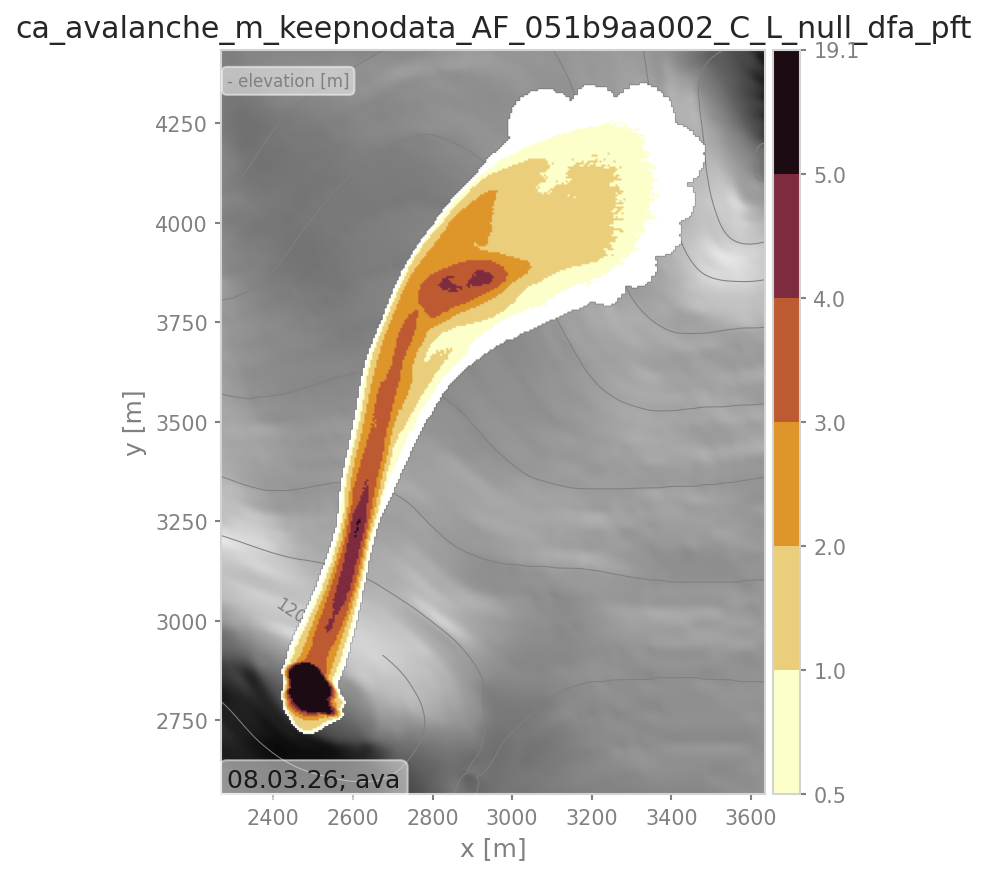
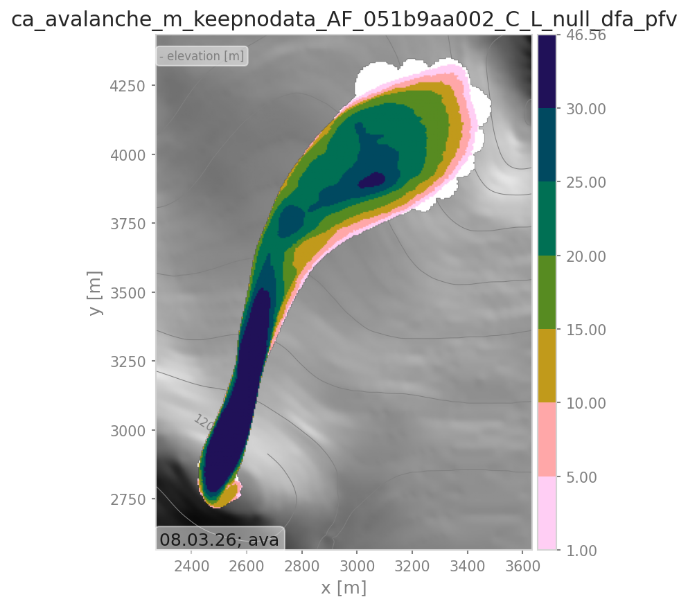
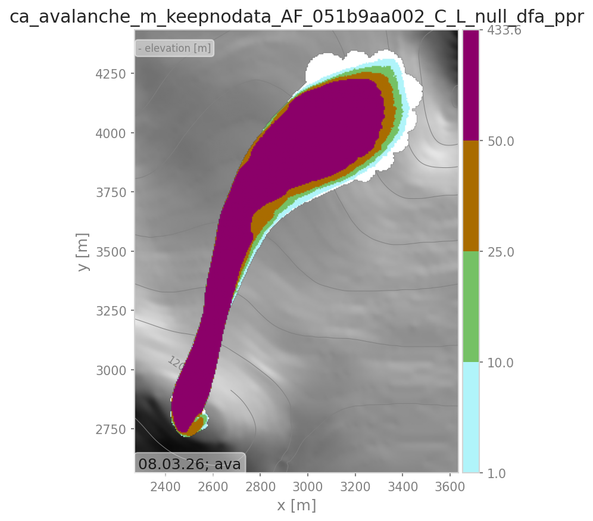

# com1DFA Simulation 
 
### Avalanche directory: */data/jobs/cascadia-test-003/ava* 
 
### Simulation name: *ca_avalanche_m_keepnodata_AF_051b9aa002_C_L_null_dfa* 
 
### Date: 08/03/2026 22:52:26 
 
### Simulation Parameters 
 
| Parameters | Values | 
| ---------- | ------ | 
| Program version | 2.0b2 | 
| Parameter set | Changed | 
| Release Area Scenario | ca_avalanche_m_keepnodata | 
| Entrainment | No | 
| Resistance | No | 
| Secondary release area | No | 
| Density [kgm-3] | 200 | 
| Friction model | samosAT | 
| Initial mass [kg] | 23040086.94 | 
| Final mass [kg] | 23040086.94 | 
| Entrained mass [kg] | 0.00 | 
| Entrained volume [m3] | 0.00 | 
| Stop criterion | < 1.00 percent of PKE | 
| Avalanche run time [s] | 279.00 | 
| Computation time [s] | 940.02 | 
 
### Release Area 
 
| Release area scenario | Release Area | Release thickness [m] | Projected Area [m2] | Actual Area [m2] | Model release volume [m3] | 
| ----------| ----------| ----------| ----------| ----------| ----------| 
| ca_avalanche_m_keepnodata | from raster | from raster | 212325.00 | 316421.04 | 115200.43 | 
 
### Friction model 
 
| model | mu | tau0 | Rs0 | kappa | R | B | 
| ----------| ----------| ----------| ----------| ----------| ----------| ----------| 
| samosAT | 0.155 | 0 | 0.222 | 0.43 | 0.05 | 4.13 | 
 
### Parameters changed from default 
 
| Parameters | Values | 
| ---------- | ------ | 
| GENERAL->tSteps | 0:10 (default is 1) | 
| GENERAL->secondaryRelThFromFile | False (default is True) | 
| GENERAL->entThFromFile | False (default is True) | 
| GENERAL->frictModel | samosAT (default is samosATAuto) | 
| INPUT->thFromIni | 1.5 (default is ) | 
| EXPORTS->exportRasters | True (default is False) | 
 
### Simulation Results 
 
##### Figure:   pft 
 
 
 
 
##### Figure:   pfv 
 
 
 
 
##### Figure:   ppr 
 
 
 
 
